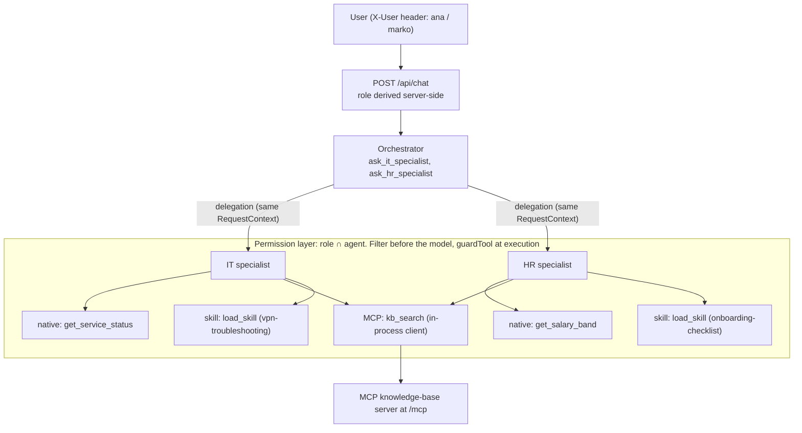

# Acme IT/HR assistant

A small multi-agent assistant for first-level IT and HR questions, running on Cloudflare Workers. The company ("Acme d.o.o.") and all its data are fictional, and every external system is simulated.

## 1. Overview

Three agents, one user-facing:

- **Orchestrator** receives every user message, delegates to specialists, asks follow-up questions and writes the single final answer.
- **IT specialist** and **HR specialist** do the delegated work and return the result only to the orchestrator. They have no delegation tools, and their prompts do not mention other agents.

The three agents are three configurations (`AgentSpec`: id, system prompt, tools, max steps) of one function, `runAgent()` in [src/agents/runAgent.ts](src/agents/runAgent.ts). There are no separate deployments. The two specialists share one parameterised file, [src/agents/specialists.ts](src/agents/specialists.ts).



The orchestrator's own tools are also filtered and guarded (it only has the two delegation tools).

## 2. Quick start

Prerequisites: **Node 22.12 or newer** (required by Wrangler and Vite; `engines` in package.json is `>=22.12.0`, `.nvmrc` says `22`).

```bash
npm install
cp .dev.vars.example .dev.vars   # then fill in ANTHROPIC_API_KEY
npm run dev                      # builds the UI (predev), then runs wrangler dev
# open http://localhost:8787
npm test
npm run typecheck
```

`.dev.vars.example` contains exactly:

```
ANTHROPIC_API_KEY=
ENABLE_SMOKE=
```

`ENABLE_SMOKE=true` enables the dev-only `GET /api/_smoke` route, which makes one real model call to check the provider setup. `.dev.vars` is gitignored; never commit a key.

**Tests need no network and no API key.** They use a mock model and an in-memory or in-process MCP server. The other scripts are `build:ui` (Vite build of `ui/` into `ui-dist/`) and `types` (`wrangler types`).

## 3. Model

- **Provider/model:** Anthropic via `@ai-sdk/anthropic`, behind `getModel(env)` in [src/model.ts](src/model.ts). The default from [wrangler.jsonc](wrangler.jsonc) is `MODEL_PROVIDER=anthropic`, `MODEL_ID=claude-haiku-5-5`. The key is `ANTHROPIC_API_KEY` in `.dev.vars`.
- **Why:** reliable tool calling, including several tool calls in one step (which is how the orchestrator delegates in parallel), at low latency and cost. Workers AI was considered (it would keep everything on Cloudflare) but was not implemented or evaluated.
- **Swapping:** change `MODEL_ID` in wrangler.jsonc for another Anthropic model. A new provider is one new `case` in `getModel` plus an entry in `SUPPORTED_PROVIDERS`. Invalid configuration throws a `ModelConfigError` naming the missing variable.
- Each user message makes several model calls (orchestrator step(s), plus each specialist's steps).

## 4. Roles and permissions

Users (predefined in [src/users.ts](src/users.ts); the "switcher" is the `X-User` header):

| User | Role |
|---|---|
| `ana` | employee |
| `marko` | manager |

The tables below were generated from `CAPABILITIES` in [src/permissions/registry.ts](src/permissions/registry.ts), the single source of truth. Anything not listed is denied.

**Capabilities per role**

| Capability | Kind | Description | employee | manager |
|---|---|---|---|---|
| `get_service_status` | native | checking the status of company services | yes | yes |
| `get_salary_band` | native | access to salary bands | no | yes |
| `kb_search` | mcp | searching the company knowledge base | yes | yes |
| `load_skill` | skill | loading detailed step-by-step guides | yes | yes |
| `ask_it_specialist` | delegation | asking the IT specialist | yes | yes |
| `ask_hr_specialist` | delegation | asking the HR specialist | yes | yes |

**Capabilities per agent**

| Capability | orchestrator | it | hr |
|---|---|---|---|
| `get_service_status` | no | yes | no |
| `get_salary_band` | no | no | yes |
| `kb_search` | no | yes | yes |
| `load_skill` | no | yes | yes |
| `ask_it_specialist` | yes | no | no |
| `ask_hr_specialist` | yes | no | no |

**Rule:** effective permission = the user's role permissions ∩ the agent's permissions (`isAllowed` in [src/permissions/policy.ts](src/permissions/policy.ts)).

- **Filtered before the model:** `filterTools` removes denied tools, so the model never sees them.
- **Checked again at execution:** `guardTool` wraps each tool and returns `{ error: "forbidden" }` if the check fails, even if the filter were bypassed.
- **Default deny:** unknown capability ids are refused.
- **MCP:** discovered tools pass through an explicit `MCP_TOOL_MAP` (unmapped tools are dropped). The knowledge-base `domain` argument is pinned per agent in code and is not in the schema the model sees.

Examples:

- **One role only:** `get_salary_band` is for managers only. Marko gets salary bands through the HR specialist; for Ana the tool is not in the HR specialist's tool set at all.
- **One agent only:** `get_service_status` is for the IT specialist only. The HR specialist has no such tool for either role.

**Delegation preserves the user's permissions.** The specialists run with the same `RequestContext` object as the orchestrator (role, abort signal, trace). The role comes only from the `X-User` header via `users.ts`. A `role` or `userId` in the request body is ignored.

**Unavailable capabilities are stated, not offered.** The specialist prompt includes lines from `describeUnavailable` for what the role cannot use (for example "Not available for your role: access to salary bands" for employees), and the orchestrator's prompt gets the same restrictions from the registry. Both prompts tell the model not to offer anything listed as unavailable. Prompts never mention that other agents exist (delegation capabilities are excluded from these lists). `GET /api/capabilities` reports the same registry-derived view per agent with `available: true/false`.

## 5. Orchestration

The orchestrator has only two tools: `ask_it_specialist` and `ask_hr_specialist`, each taking a self-contained task text. The prompt rules in [src/agents/orchestrator.ts](src/agents/orchestrator.ts) tell it to:

- **Independent tasks:** call both specialists in the same step. The AI SDK executes the tool calls of one step concurrently, so they run in parallel.
- **Dependent tasks:** delegate one after the other and put the relevant facts from the first result into the next task text.
- **Missing information:** ask the user one short follow-up question instead of delegating or guessing.

Each delegation returns a `DelegationResult { status, agent, content }`. `status` is one of:

| Status | Meaning |
|---|---|
| `ok` | The specialist finished. |
| `error` | The run failed (provider error, step limit, empty answer, invalid task). |
| `timeout` | The specialist or the whole request ran out of time. |
| `unavailable` | The specialist could not be started, or the delegation budget was used up. |
| `forbidden` | The guard refused the delegation for this role. |

Anything other than `ok` is described in the tool description as "the task was NOT done", and the prompt rules require the orchestrator to say what could not be done and not to invent content. Error text is built from fixed strings and HTTP status codes only; raw provider messages never reach the user.

**Limits** (all in [src/config.ts](src/config.ts)):

| Constant | Value | What it bounds |
|---|---|---|
| `MAX_STEPS_ORCHESTRATOR` | 8 | model steps for the orchestrator |
| `MAX_STEPS_SPECIALIST` | 5 | model steps per specialist run |
| `AGENT_TIMEOUT_MS` | 25 000 | one agent run |
| `REQUEST_TIMEOUT_MS` | 60 000 | the whole HTTP request |
| `MAX_INPUT_CHARS` | 2 000 | user message and delegated task length |
| `MAX_DELEGATIONS_PER_REQUEST` | 4 | specialist delegations per request |
| `MCP_CONNECT_TIMEOUT_MS` | 3 000 | MCP connect + `listTools` |
| `MCP_CALL_TIMEOUT_MS` | 5 000 | one MCP tool call |

`MAX_HISTORY_MESSAGES` (20) is also defined there, but nothing currently uses it. It is meant for session history pruning (see section 9).

## 6. Skills and MCP

**Skills.** Two skills, stored as `SKILL.md` files with frontmatter (name, description, agents): `vpn-troubleshooting` (IT) and `onboarding-checklist` (HR) under [src/skills/](src/skills/). Workers have no filesystem at runtime, so the files are bundled as text modules (wrangler `rules` for `**/*.md`) and indexed explicitly in [src/skills/index.ts](src/skills/index.ts). The system prompt of an agent contains only each skill's name and description. The full body is returned by the `load_skill` tool, whose name argument is an enum of that agent's own skills; loading is re-checked in `loadSkill`, so the HR specialist cannot load an IT skill.

The demonstrated execution is the test "loads the skill on demand, applies its steps and answers from the real status" in [test/skills-demo.test.ts](test/skills-demo.test.ts). It runs the real `runAgent` with a mock model and asserts that the prompt has no skill body, that the tool result does, and that `skill_loaded` comes before `get_service_status`. The trace is saved in [test/__fixtures__/vpn-demo-trace.txt](test/__fixtures__/vpn-demo-trace.txt). In the UI, press the **Skill** demo button ("My VPN is not working.") and look for the highlighted `skill_loaded` row in the trace panel (this needs a real model and key; it is a manual check).

**MCP.** [src/mcp/server.ts](src/mcp/server.ts) is a real MCP server (`@modelcontextprotocol/sdk`, stateless Streamable HTTP) mounted at `/mcp` in the same Worker. It exposes one tool, `search_knowledge_base`, over a fictional knowledge base ([src/data/kb.ts](src/data/kb.ts)). The agents reach it through [src/mcp/client.ts](src/mcp/client.ts): an MCP `Client` with the SDK's Streamable HTTP transport whose `fetch` is answered in-process by `handleMcpRequest`, so the protocol is real but there is no network call to the Worker's own origin. The client discovers tools with `listTools`, maps them to capability ids through `MCP_TOOL_MAP` (`search_knowledge_base` -> `kb_search`), then filters and guards them like any other tool. If the server cannot be reached, the agent gets no KB tool, an `mcp_unavailable` trace event is recorded and its prompt says the knowledge base is unavailable. The orchestrator never gets MCP tools.

## API and UI

- `GET /api/users`: the predefined users (id, label, role).
- `GET /api/capabilities` (needs `X-User`): capabilities per agent for that user, with `available` flags.
- `POST /api/chat` (needs `X-User`, body `{ "message": string }`, 1-2000 characters): returns `{ reply, status, trace }`. Stateless.
- `GET /api/_smoke`: dev-only, 404 unless `ENABLE_SMOKE=true`.
- `GET /health`, and `/mcp` for the MCP server.

The React UI in [ui/](ui/) is built by Vite into `ui-dist/` and served by the Worker as static assets (`/api/*`, `/mcp` and `/health` go to the Worker first). It has a user switcher, a capabilities panel, four demo buttons (Parallel, Dependent, Restricted, Skill) and an execution-trace panel that groups overlapping specialist runs under "ran in parallel".

## 7. Trade-offs

| Choice | Alternative | Reason |
|---|---|---|
| Vercel AI SDK (`ai`) with `generateText` and tool sets | Cloudflare Agents SDK | The AI SDK is provider-agnostic, so the model is one function (`getModel`), and a mock model makes tests simple. The Agents SDK would tie agents to Durable Objects and a different state model, which this prototype does not need yet. |
| Three configurations of one `runAgent` | Three deployments or three agent classes | One loop with one set of limits, timeouts and tracing is easier to reason about and test, and the task says separate deployments are not required. |
| Filter tools before the model, and check again at execution | Filter only, or check only | Filtering keeps unavailable tools out of the model's reach (and prompts honest). The execution check is the safety net if a filter is bypassed or a tool is wired wrongly. |
| MCP server in the same Worker, in-process client | Separate MCP Worker | No extra deployment and no network hop, while still using the real protocol and discovery. A separate Worker is the production shape (see section 9). |
| Skills bundled as text modules, indexed explicitly | Read skill files at runtime | Workers have no filesystem. Bundling makes the skill set fixed per deployment. |
| Anthropic | Workers AI | Chosen for tool-calling reliability and parallel delegation. Workers AI was not tried, so there is no measured comparison. |
| Stateless API (each request independent) | Sessions in a Durable Object | Not built because the task is time-boxed. It means no memory across messages (see section 9). |
| Error messages from fixed text and status codes | Scrubbing provider errors | Scrubbing can miss something. Fixed text cannot leak a key, header or prompt. |
| Keyword search in the mock knowledge base | Embeddings / vector search | The articles are few and fictional. Substring scoring (title weighted higher) is deterministic and testable. |

## 8. Requirements coverage

"Test" gives the file and the exact test title. "manual only" means there is no automated test; some of these need a real model and key.

| Requirement | Status | Where | Test |
|---|---|---|---|
| Exactly three agents (orchestrator, IT, HR), no separate interaction agent | Done | `AGENT_IDS` in [src/types.ts](src/types.ts); [src/agents/runAgent.ts](src/agents/runAgent.ts), [src/agents/orchestrator.ts](src/agents/orchestrator.ts), [src/agents/specialists.ts](src/agents/specialists.ts) | [test/specialists.test.ts](test/specialists.test.ts): "IT: loads the skill (body only via tool result), checks status, closes the client" (IT through the real `runAgent`); [test/orchestrator.test.ts](test/orchestrator.test.ts): "orchestrator has exactly the two ask_* tools (%s)" |
| Delegation to the right specialist | Done (routing is by prompt and tool descriptions, so model-dependent) | [src/agents/orchestrator.ts](src/agents/orchestrator.ts) | [test/orchestrator.test.ts](test/orchestrator.test.ts): "the specialist receives the identical ctx object"; routing quality with a real model: manual only |
| Independent tasks run concurrently | Done | [src/agents/orchestrator.ts](src/agents/orchestrator.ts) (tool calls of one step run concurrently in the AI SDK) | [test/orchestrator.test.ts](test/orchestrator.test.ts): "two delegations in one step overlap: total ≈ max, not sum" |
| Dependent tasks run sequentially, results passed on | Done | [src/agents/orchestrator.ts](src/agents/orchestrator.ts) | [test/orchestrator.test.ts](test/orchestrator.test.ts): "second task contains a value from the first result and starts after it ended" |
| One coherent final response | Done | [src/agents/orchestrator.ts](src/agents/orchestrator.ts) (only the orchestrator answers the user) | [test/api.test.ts](test/api.test.ts): "%s gets a reply, status and trace" |
| Honest handling of missing information and failures | Done | [src/agents/orchestrator.ts](src/agents/orchestrator.ts), [src/agents/runAgent.ts](src/agents/runAgent.ts), [src/mcp/client.ts](src/mcp/client.ts) | [test/orchestrator.test.ts](test/orchestrator.test.ts): "a follow-up question without tool calls is ok with zero delegations", "a hanging specialist yields timeout and the orchestrator answers honestly", "connectMcp rejecting -> unavailable, no message leak"; wording of real answers: manual only |
| Own instructions, message history and tools per agent | **Partial**: instructions and tools are separate; history exists only within one request (see section 9) | [src/agents/specialists.ts](src/agents/specialists.ts), [src/agents/orchestrator.ts](src/agents/orchestrator.ts) | [test/specialists.test.ts](test/specialists.test.ts): "domain texts differ and contain no forbidden words"; [test/orchestrator.test.ts](test/orchestrator.test.ts): "a specialist reads only its own history" |
| Bounded execution (steps, timeouts, input length) | Done | [src/config.ts](src/config.ts), [src/agents/runAgent.ts](src/agents/runAgent.ts) | [test/runAgent.test.ts](test/runAgent.test.ts): "fails honestly when the step limit is reached without a final answer", "times out after the per-agent timeout"; [test/orchestrator.test.ts](test/orchestrator.test.ts): "calls beyond the budget are unavailable and run nothing" |
| Native tool with validated input and a useful result | Done | [src/tools/native.ts](src/tools/native.ts), [src/data/mock.ts](src/data/mock.ts) | [test/native-tools.test.ts](test/native-tools.test.ts): "rejects invalid input with a clear error", "returns status for a valid service" |
| MCP: discovery and invocation through a working client/server connection | Done | [src/mcp/server.ts](src/mcp/server.ts), [src/mcp/client.ts](src/mcp/client.ts) | [test/mcp-client.test.ts](test/mcp-client.test.ts): "works through handleMcpRequest in-process (real protocol, no network)"; [test/mcp-server.test.ts](test/mcp-server.test.ts): "lists tools over Streamable HTTP" |
| Skill loaded on demand, with a demonstrated execution | Done | [src/skills/](src/skills/), [src/tools/skills.ts](src/tools/skills.ts) | [test/skills-demo.test.ts](test/skills-demo.test.ts): "loads the skill on demand, applies its steps and answers from the real status"; UI demo with a real model: manual only |
| Two roles with meaningfully different permissions | Done | [src/users.ts](src/users.ts), [src/permissions/registry.ts](src/permissions/registry.ts) | [test/users.test.ts](test/users.test.ts): "resolves ana as employee and marko as manager"; [test/api.test.ts](test/api.test.ts): "differs between ana and marko and is grouped by agent" |
| A capability for one role only | Done (`get_salary_band`, manager only) | [src/permissions/registry.ts](src/permissions/registry.ts) | [test/api.test.ts](test/api.test.ts): "salary question: refused for employee, answered for manager (full path)"; [test/native-guard.test.ts](test/native-guard.test.ts): "does not touch the salary data for an employee" |
| A capability for one agent only | Done (`get_service_status`, IT only) | [src/permissions/registry.ts](src/permissions/registry.ts) | [test/specialists.test.ts](test/specialists.test.ts): "IT never has get_salary_band, HR never has get_service_status" |
| Only capabilities permitted for both the user and the agent are exposed | Done | [src/permissions/policy.ts](src/permissions/policy.ts) | [test/permissions.test.ts](test/permissions.test.ts): "covers every combination exactly once", "refuses when called directly with the filter bypassed, without running the tool" |
| Delegation preserves the user's permissions | Done | [src/agents/orchestrator.ts](src/agents/orchestrator.ts), [src/routes/api.ts](src/routes/api.ts) | [test/orchestrator.test.ts](test/orchestrator.test.ts): "the specialist receives the identical ctx object"; [test/api.test.ts](test/api.test.ts): "ignores role and userId in the body" |
| Agents do not offer unavailable capabilities | Done (prompt-level, model-dependent; the tools themselves are removed in code) | [src/permissions/policy.ts](src/permissions/policy.ts) (`describeUnavailable`), [src/agents/specialists.ts](src/agents/specialists.ts) | [test/permissions.test.ts](test/permissions.test.ts): "tells an employee that salary bands are unavailable"; [test/specialists.test.ts](test/specialists.test.ts): "describeUnavailable text appears for employee+hr and not for manager+hr" |
| Strict TypeScript, Cloudflare Workers, tool-calling LLM, MCP, automated tests | Done | [tsconfig.json](tsconfig.json), [wrangler.jsonc](wrangler.jsonc), [src/model.ts](src/model.ts) | `npm run typecheck`, `npm test` |
| README with roles, model, configuration, trade-offs | Done | this file | n/a |

## 9. Not implemented, limitations and next steps

### Persistent conversation history

Not implemented, because the task is time-boxed. Nothing persists between requests: every `POST /api/chat` is independent, so if the assistant asks a follow-up question, the user's answer in the next message is a new, unrelated request. Each agent has its own instructions and tools, and its own message history only within a single request. The `SessionDO` class and its binding in `wrangler.jsonc` exist but are unused ([src/session/SessionDO.ts](src/session/SessionDO.ts)). `MAX_HISTORY_MESSAGES` in `src/config.ts` is defined for the same purpose and is also unused.

How it would be built:

- One Durable Object per `sessionId:userId`: `sessionId` validated, `userId` in the key so users are isolated.
- A SQLite table `messages(agent, json, created_at)`, with one history per agent.
- Schema validation when messages are read back.
- Pruning per agent, so a window never starts with an assistant message or an orphan tool message.
- Failed rounds are not stored.
- An in-flight flag that makes a concurrent request return 409.
- The role is always derived server-side, never taken from stored or client data.
- A reset route.

### Testing

Test coverage was not audited systematically: there is no coverage report and no mutation testing. The permission tests assert literal expected values (for example the full role x agent x capability matrix in [test/permissions.test.ts](test/permissions.test.ts)), not values computed from the registry.

### Behaviour observed with the real model

In manual runs, the assistant occasionally says it only saw excerpts of a knowledge-base article although it receives the full text, and it sometimes widens a delegated task beyond what the user asked. Neither affects permissions or limits, which are enforced in code. Next step: a small evaluation set run against the real model.

### Other limitations

- The header-based user switcher is spoofable by design (no authentication; out of scope).
- No streaming: the reply arrives when the whole request is done.
- No rate limiting.
- Aborting a request in the browser does not stop the Worker.
- The MCP server runs in the same Worker, and knowledge-base search is simple keyword matching.
- All company data is fictional ("Acme d.o.").
- UI logic is tested only for the trace view ([test/trace.test.ts](test/trace.test.ts), [test/trace-schema.test.ts](test/trace-schema.test.ts)); there are no browser tests.
- Timing-sensitive tests (for example the parallel-delegation check) can be sensitive to machine load.
- In the trace, the delegated `task` and tool results are truncated to 200 characters.

### Production next steps

- Real authentication and identity.
- A separate MCP Worker protected with OAuth.
- Sessions as described above.
- Streaming.
- Rate limiting and per-user budgets.
- Observability beyond the Worker logs.
- An evaluation suite.
- Secrets via `wrangler secret` instead of `.dev.vars`.
